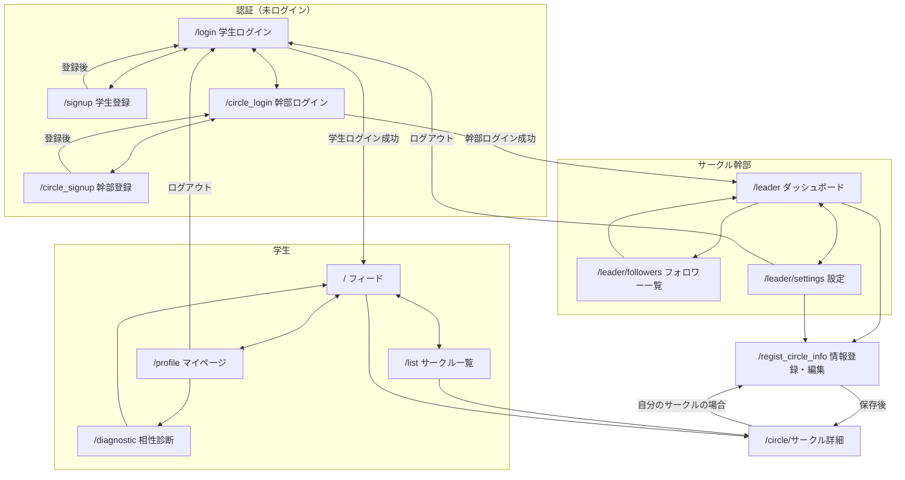

# CampusHub (NUCS)

長崎大学のサークル検索アプリ（Flask + SQLite）。

## 状態遷移図

画面遷移はすべて app.py のルートで管理している（1画面 = 1URL）。

- 未ログインで各ページを開くと /login へリダイレクトされる
- 幹部が学生のページを開くと /leader へ、学生が幹部のページを開くと / へリダイレクトされる
- 投稿・フォロー・削除などの処理は POST のあと元の画面へリダイレクトされる（PRG パターン）
